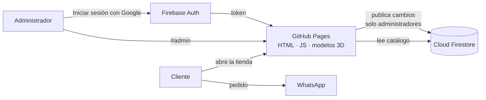

# 🎨 M&Y Studio · Tienda web de sublimados con personalizador 3D

Tienda online para un taller de **sublimación y productos personalizados** (polos, tazas, mousepads, accesorios y regalos). Los clientes **diseñan su producto en 3D**, lo ven en 360° antes de comprar y envían el pedido por **WhatsApp**. El dueño administra todo el catálogo desde un **panel con inicio de sesión de Google**, sin tocar código.

🔗 **Demo en vivo:** [roymister.github.io/mystudio](https://roymister.github.io/mystudio/)

<!-- Agrega capturas en docs/capturas/ y descomenta estas líneas:


-->

---

## ✨ Funcionalidades

### Para clientes
- **Catálogo** con más de 30 productos en 5 categorías, buscador y carrusel de promociones.
- **Personalizadores 3D** (Three.js) para **polos, tazas y mousepads**:
  - Rotación 360°, zoom y vistas rápidas (frente, espalda, lados).
  - Cambio de color del producto, del cuello/puños o del borde cosido.
  - **Diseños proyectados sobre la superficie real** (calcomanías que siguen arrugas y curvas): logos, textos o imágenes propias, en cualquier parte del producto.
  - **Estampado completo** (sublimación total) con patrones o imagen propia.
  - Mousepad con **tamaños reales** (22×18 hasta 90×40 cm) que cambian el modelo 3D.
- **Carrito** con descuento automático por volumen y **envío del pedido por WhatsApp** con el detalle armado.
- **Cotizador** para empresas y eventos (doble cara, entrega urgente, descuentos por cantidad).
- Diseño **responsive** (celular, tablet y escritorio).

### Para el administrador
- **Inicio de sesión con Google** (Firebase Authentication + Google Identity Services), compatible con celulares.
- **Panel del dueño** para crear, editar, duplicar, ocultar y eliminar productos, categorías, diapositivas del carrusel y ajustes de la tienda (nombre, WhatsApp, medios de pago, descuentos por volumen).
- Precios con **descuento por producto**, fotos subidas (comprimidas en el navegador) o por enlace.
- **Publicación instantánea**: los cambios se guardan en Firestore y los clientes los ven al momento.
- **Borrador automático** y vista previa antes de publicar.

---

## 🛠️ Tecnologías

| Área | Tecnología |
|---|---|
| Interfaz | **React 18** + **htm** (JSX sin compilación), HTML5, CSS3 |
| 3D | **Three.js** (GLTFLoader, OrbitControls, DecalGeometry), modelos glTF/GLB |
| Autenticación | **Firebase Authentication** + **Google Identity Services** |
| Base de datos | **Cloud Firestore** con reglas de seguridad |
| Hosting | **GitHub Pages** |
| Build | **Python** (script que empaqueta la app en `docs/`) |
| Integraciones | WhatsApp (enlaces `wa.me`), Unsplash (fotos de referencia) |

---

## 🧱 Arquitectura



- La página es **estática** (sin servidor propio): se publica en GitHub Pages.
- El catálogo vive en **Firestore**; si Firebase no responde, la tienda usa una copia incluida en la página.
- La **seguridad** está en las reglas de Firestore: cualquiera puede leer la tienda, pero **solo los administradores autorizados pueden escribir**.

---

## 📁 Estructura del proyecto

```
├── build.py               # Empaqueta src/, styles/ y data/ en docs/
├── src/
│   ├── app.js             # App: rutas, catálogo, carrito, cotizador, páginas 3D
│   ├── admin.js           # Panel del dueño e inicio de sesión
│   ├── firebase-store.js  # Conexión con Firebase (auth + Firestore)
│   ├── sim.js             # Motor del personalizador 3D (polo, taza, mousepad)
│   ├── sim-markup.html    # Paneles del personalizador
│   └── art.js             # Ilustraciones SVG de productos
├── styles/                # Estilos de la tienda y del personalizador
├── data/store-data.json   # Catálogo inicial (respaldo)
├── assets/*.glb           # Modelos 3D
└── docs/                  # Sitio generado que publica GitHub Pages
```

---

## 🚀 Ejecutar en local

Requisitos: **Python 3**.

```bash
python build.py
cd docs
python -m http.server 8080
```

Abre `http://localhost:8080` (tienda) o `http://localhost:8080/#admin` (panel).

---

## 🔐 Seguridad

- Sin contraseñas ni claves privadas en el repositorio; la configuración web de Firebase es pública por diseño.
- Administradores definidos por **ID de usuario de Firebase** en las reglas de Firestore.
- Escritura bloqueada para cualquier usuario no autorizado; el resto de la base de datos está cerrada.

---

## 💡 Retos y aprendizajes

- **Proyectar diseños sobre telas y superficies curvas** sin deformaciones: filtrado de triángulos de la calcomanía según la normal de la superficie.
- **Modelos 3D con normales invertidas**: detección y corrección automática en el navegador.
- **Inicio de sesión en celulares**: Safari y Chrome móvil aíslan el almacenamiento entre sitios; se resolvió con Google Identity Services y aviso para navegadores internos (WhatsApp, Instagram).
- **Panel sin código para un negocio real**: guardado incremental (solo lo que cambió) y lotes pequeños para respetar los límites de Firestore.

---

## 📦 Créditos

- Modelo 3D del polo: *"men POLO shirt, camouflage pattern"* de **funlab117** (Sketchfab), licencia [CC BY 4.0](http://creativecommons.org/licenses/by/4.0/). Modificado: se retiró el estampado original.
- Modelo 3D del mousepad: *"mouse pad (keyboard pad)"* de **mfk** (Sketchfab), licencia [CC BY 4.0](http://creativecommons.org/licenses/by/4.0/). Modificado: colores y tamaño.
- Modelo 3D de la taza: *"Taza"* de **little bread 34** (Sketchfab), licencia Sketchfab Standard.
- Fotos de referencia: [Unsplash](https://unsplash.com).
- Desarrollado con apoyo de **Claude (Anthropic)** como asistente de programación.

---

## 👤 Autor

**Roy Malpartida Sánchez**
Estudiante de Ingeniería de Sistemas · Universidad César Vallejo


